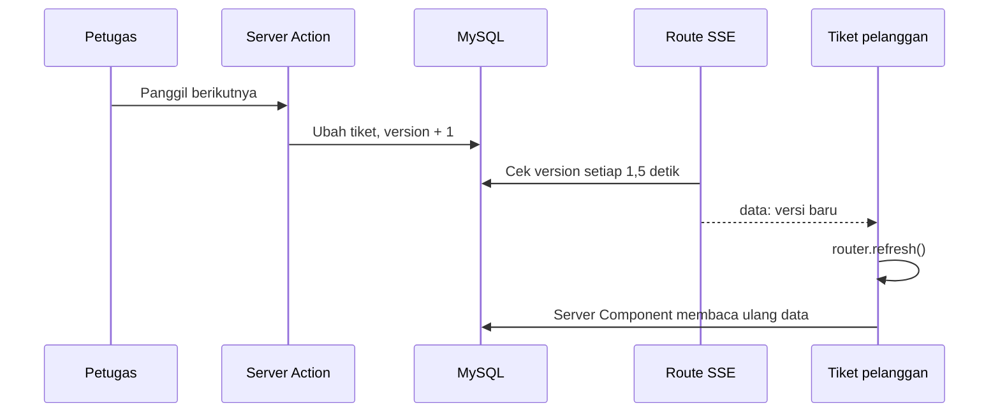

# Cara kerja Lapak Antre

Dokumen ini menjelaskan cara kerja setiap bagian dan alasan di balik pilihannya. Setiap bagian menyebut file yang perlu kamu baca. Untuk menjalankan proyek, lihat [README](../README.md).

## Data dibaca di server, interaksi di client

Semua halaman adalah Server Component yang membaca data lewat fungsi di `lib/queries.ts`. Komponen client (`"use client"`) hanya dipakai untuk bagian yang butuh interaksi, seperti form, tombol konsol, dan tiket live.

Pembagian ini membuat JavaScript di HP pelanggan tetap kecil. Data juga tidak perlu disiapkan dua kali, satu untuk API dan satu untuk tampilan.

Contoh yang bisa kamu ikuti dari atas ke bawah ada di `app/tiket/[token]/page.tsx`. Halaman itu memanggil `getTicketView()`, lalu memberi hasilnya ke `LiveTicket` sebagai props biasa.

## Server Action adalah endpoint publik

Semua perubahan data lewat Server Action di `lib/actions.ts`. Fungsi dengan `"use server"` bisa dipanggil siapa saja yang tahu ID-nya, bukan hanya oleh form yang kita buat. Karena itu setiap action memperlakukan input sebagai data asing.

- Setiap action petugas memanggil `requireStaff()` sendiri. Layout dashboard yang terkunci tidak cukup, karena action bisa dipanggil langsung.
- Setiap query petugas memfilter `tenantId` dan `branchId` dari sesi. Nilai dari input client tidak pernah dipakai untuk memilih tenant.
- Input dipaksa menjadi string dengan `text()`, lalu dicek ulang dengan aturan di `lib/validation.ts`.

`npm run check:isolation` membuktikan bagian ini. Skrip itu membuat tenant kedua, membuka semua halaman dashboard, dan gagal kalau ada data klinik demo yang muncul.

## Login petugas dibuat sendiri

Login tidak memakai library. Kodenya ada di `lib/crypto.ts` dan `lib/auth.ts`.

- Kata sandi di-hash dengan scrypt dan salt acak. Perbandingannya memakai `timingSafeEqual`, supaya waktu respons tidak membocorkan isi hash.
- Sesi berupa token acak 256 bit di cookie `la_session` yang `httpOnly`. Database hanya menyimpan hash sha256 dari token itu. Kalau database bocor, token aslinya tetap aman.
- Pesan gagal login sama untuk email salah dan kata sandi salah. Dengan begitu orang lain tidak bisa mengecek email mana yang terdaftar.

Pilihan ini cukup untuk email dan kata sandi. Kalau nanti butuh magic link atau login Google, pindah ke library seperti Better Auth lebih masuk akal.

## Nomor tiket tidak pernah dobel

Dua pelanggan bisa menekan tombol "Ambil nomor" di detik yang sama. Kodenya ada di `lib/ticket-number.ts`.

```sql
INSERT INTO DailyCounter (serviceId, date, lastNumber) VALUES (?, ?, 1)
ON DUPLICATE KEY UPDATE lastNumber = lastNumber + 1;
SELECT lastNumber FROM DailyCounter WHERE serviceId = ? AND date = ?;
```

Kedua query berjalan di satu transaksi. Upsert mengunci barisnya sampai commit, jadi request kedua menunggu request pertama selesai. `SELECT` di transaksi yang sama selalu membaca hasil kenaikannya sendiri. Unique index `(serviceId, date, number)` di tabel `Ticket` menjadi pengaman terakhir.

Tanggal dikirim sebagai teks `YYYY-MM-DD`. Objek `Date` mentah akan digeser driver sesuai zona waktu komputer.

`npm run check:race` membuktikan bagian ini dengan 40 transaksi bersamaan.

Memanggil pelanggan memakai pola yang sama. `callNext()` mengklaim tiket dengan `updateMany({ where: { id, status: "WAITING" } })`. Kalau loket lain sudah lebih dulu, hasilnya 0 baris dan kode mencoba tiket berikutnya.

## QR harian mencegah ambil nomor dari rumah

Link ambil nomor membawa `?k=`, yaitu HMAC-SHA256 dari `Branch.qrSecret` dan tanggal lokal cabang. Kodenya ada di `dailyQrCode()` di `lib/crypto.ts`. Kode itu berganti setiap hari, jadi foto poster kemarin tidak bisa dipakai lagi.

Setiap perangkat juga hanya boleh punya satu tiket aktif per layanan, lewat cookie `la_t_<serviceId>`.

Sebagai penahan banjir, satu jaringan dibatasi 20 tiket per cabang dalam 10 menit. Batasnya sengaja tinggi. Operator seluler di Indonesia memakai CGNAT, sehingga banyak pelanggan sungguhan berbagi satu IP. Database hanya menyimpan hash dari IP, tidak pernah IP mentahnya.

## Realtime lewat SSE dan nomor versi

Setiap perubahan antrean menaikkan `Branch.version` sebanyak 1.



Kode servernya ada di `app/api/branches/[branchId]/events/route.ts`, dan kode client-nya di `components/queue/live-refresh.tsx`.

Ada tiga alasan memilih cara ini:

- Vercel menjalankan beberapa instance yang tidak berbagi memori. `EventEmitter` di satu instance tidak terdengar oleh instance lain. Kolom di database bisa dibaca semua instance.
- Event hanya berisi nomor versi, bukan data. Client selalu me-render ulang dari server, jadi event yang hilang tidak membuat tampilan salah.
- Fungsi di Vercel Hobby berhenti setelah 300 detik. Stream ditutup di 280 detik, lalu `EventSource` di browser menyambung ulang sendiri dengan membawa versi terakhir.

Kekurangannya, setiap layar yang terbuka menjalankan satu query ringan setiap 1,5 detik. Untuk lalu lintas besar, gantilah dengan Redis pub/sub.

## Kenapa tanpa React Query dan Redux

React Query mengelola data yang diambil di client. Di proyek ini data dibaca di server dan realtime sudah ditangani SSE, jadi tidak ada data client yang perlu dikelola. Memakainya berarti menambah endpoint JSON dan memindahkan render ke client tanpa masalah yang diselesaikan.

Redux mengelola state client yang dipakai banyak komponen. Di proyek ini state seperti itu tidak ada, dan tema sudah diurus `next-themes`.

React Query baru layak kalau nanti ada aplikasi mobile yang memakai API yang sama, atau layar dengan filter dan paginasi di client.

## Notifikasi: di halaman dan lewat Web Push

Ada dua jalur notifikasi.

1. Selama halaman tiket terbuka, `LiveTicket` membandingkan status sebelum dan sesudah refresh. Kalau pelanggan baru saja dipanggil atau masuk batas `notifyAhead`, halaman menampilkan notifikasi.
2. Kalau halaman sudah ditutup, server mengirim Web Push. Kodenya ada di `lib/push.ts`, dan service worker di `public/sw.js` menampilkannya.

Beberapa detail yang perlu dipelajari:

- Notifikasi ditampilkan lewat `registration.showNotification()`. Android Chrome menolak `new Notification()` dari halaman.
- Kedua jalur memakai kode tiket sebagai `tag`. HP hanya menampilkan satu notifikasi, bukan dua.
- Push "sudah dekat" diklaim dengan `updateMany({ where: { nearNotifiedAt: null } })`. Dua panggilan yang terjadi bersamaan tetap mengirim push itu satu kali.
- Push dikirim di dalam `after()` dari `next/server`. Tombol petugas tidak menunggu layanan push Google.
- Langganan yang dibalas 404 atau 410 dihapus, karena browser sudah membatalkannya.
- Service worker didaftarkan sebagai `/sw.js?dev=1` di mode pengembangan. Di mode itu service worker hanya menangani push dan tidak menyimpan cache.

## Form: satu aturan untuk client dan server

Form memakai TanStack Form. Aturan validasinya ada di satu tempat, `lib/validation.ts`, dan berupa fungsi murni.

- Di client, `fieldRule()` di `lib/form.ts` menjalankan aturan saat isian ditinggalkan dan saat submit.
- Di server, action menjalankan aturan yang sama lewat `validate()`.
- Error yang hanya bisa dicek server, seperti email yang sudah terdaftar, dikembalikan sebagai `fieldErrors`. `applyServerErrors()` menaruhnya di `errorMap.onServer` milik isian itu. `clearServerErrorOnChange` menghapusnya saat isian diubah.
- `orServerError()` mengubah error server yang tidak terduga menjadi pesan di form. Redirect tetap diteruskan.

`components/text-field.tsx` adalah contoh singkat cara menghubungkan field TanStack ke komponen shadcn.

## Perkiraan waktu tunggu

Rumusnya ada di `estimateWait()` di `lib/queue.ts`.

```
perkiraan = orang di depan x rata-rata lama layanan / jumlah loket aktif
```

Rata-rata diambil dari 20 tiket terakhir yang selesai hari itu. Kalau belum ada, rata-rata memakai `defaultMinutes` layanan. Hasilnya ditampilkan sebagai rentang kelipatan 5 menit, karena angka tepat seperti "17 menit" memberi kesan pasti yang palsu.

Perkiraan saat tiket diambil disimpan di `Ticket.predictedMinutes`. Halaman laporan membandingkannya dengan waktu tunggu sebenarnya dan menampilkan selisih rata-ratanya (MAE). Angka itu menjadi patokan untuk model regresi di masa depan. Model baru layak dipakai kalau MAE-nya lebih kecil.

## Tampilan

- `components/queue/flap-code.tsx` menampilkan nomor sebagai ubin split-flap. Setiap karakter memakai `key` berisi nilainya. Saat karakter berubah, React memasang ulang elemen itu, dan animasi CSS `flap` berjalan.
- `lib/theme-transition.ts` memakai View Transitions API. Tema baru muncul sebagai lingkaran yang membesar dari titik klik. Kalau browser tidak mendukung atau pengguna memilih reduced motion, tema langsung berganti.
- Warna diatur lewat variabel CSS di `app/globals.css`. Kelas `bg-board` dan `text-board-foreground` adalah warna papan yang dipakai ubin nomor.
